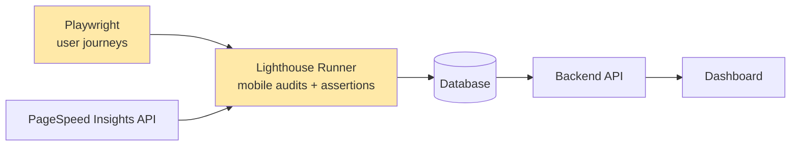

<h2 align="center">Ei Shwe Zin Phoo (Phoo)</h2>

  <b>Aspiring Solution Architect</b> · Advanced Computing @ Kyungpook National University 
  Yangon 🇲🇲 → Daegu 🇰🇷 · I want to connect business problems with the right system design

---

### 🧭 How I think

> "If you can't measure it, you can't improve it."
> A good architecture starts with understanding the problem and measuring it correctly.

| | Where it comes from | What it gives me |
|---|---|---|
| 💼 **Business** | AIESEC Myanmar business development: contacting companies for partnerships | Listening to clients and explaining ideas clearly |
| 📊 **Data** | Business analytics dashboard (Rikkeisoft internship, Vietnam) | Turning raw data into information people can use |
| ⚙️ **Engineering** | Luminara web performance project | Measuring and validating how a real system performs |

---

### 🏗️ Featured project: Luminara
**Web performance optimization & benchmarking dashboard for Decathlon Korea** (team project)

🟨 = my part

**My role: Lighthouse Runner**
- Measured page performance along real user flows on Decathlon pages with **Playwright** + **Lighthouse**
- Configured mobile audits and assertions to check results against performance criteria (Core Web Vitals)
- Saved audit results to the database for the dashboard
- Added a competitor (SSG) to compare Decathlon's performance

👉 [My part in the repo](https://github.com/Luminara-Team-9/luminara-dashboard/tree/main/4_automation_tests/lighthouse-runner)

---

### 🧰 Toolbox
**Comfortable with:** `Python` `Java` `SQL` `Git/GitHub`
**Used in projects (AI-assisted):** `JavaScript` `Lighthouse` `Playwright` `PostgreSQL` `Linux`
**Learning now:** `AWS` `Cloud architecture`

### 📚 Other work
- **Business analytics dashboard:** built individually in a 1-month internship at Rikkeisoft (Vietnam), with mentor guidance
- **SOCAR car-sharing DB design:** requirements spec → ERD → relation schema
- **Java game platform:** integrated three teammates' mini games into one platform

### 🎯 Currently working toward
- [ ] AWS Certified Solutions Architect – Associate
- [ ] Cloud architecture for AI services

### 📜 Certificates
TOPIK Ⅱ Level 5 · TOEIC 765 · IBM Full Stack Software Developer Assessment (Coursera) · Microsoft Preparing Data for Analysis with Excel (Coursera)

### 🌏 Languages
Korean (TOPIK 5) · English · Burmese (native)
